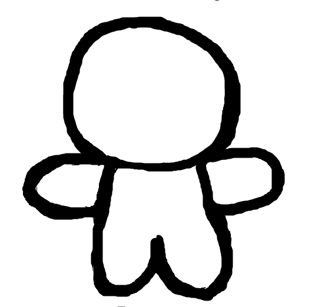
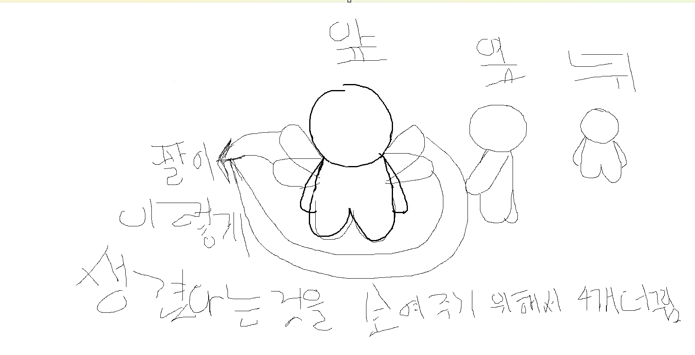

# 지식 (Knowledge) — 아트 01: 캐릭터 그림체

> 상태: 초안 (v0.5) · 출처: 기획자 스케치 v1 (`reference/character_style_v1.png`), **v2 (`reference/character_style_v2.png`, "이런 느낌")**
> 원본 스케치를 해석한 내용은 모두 기획자 확인을 거쳤다.

## 1. 기본 방향

- 단순한 그림체 (기획자 지정)
- 3면도 제공: **앞 / 옆 / 뒤**
- 구현은 **3D** (Unreal Engine)
- 이 스케치는 **베이스 바디(마네킹)** 이다. 모든 캐릭터는 이 몸 위에 얼굴·옷 등을 덧입혀 만든다.
- 마네킹은 **기본(중립) 상태**일 뿐이다. 그 위에서 **체격 조정, 복잡한 얼굴, 화려한 의상**이 가능해야 한다 → [아트 03](03_character_customization.md)
- "단순함"은 기본 몸의 특징이며, 최종 캐릭터가 반드시 단순해야 한다는 뜻이 아니다.

## 2. 스케치 v2 — 현재 기준 ("이런 느낌")

이미지(535 × 522px, 선 두께 약 18px)에서 검은 선의 바깥 경계를 직접 측정했다. 키(481px)를 1.0으로 환산한 값이며, 손그림이므로 ±10% 오차를 전제로 한다.

| 부위 | 형태 | 측정값 |
|---|---|---|
| 머리 | **원보다 가로로 약간 넓은 타원.** 목 없이 몸통에 바로 얹힘 | 300 × 261px → 가로/세로 **1.15**, 키의 **0.54** |
| 몸통 | 위가 좁고 아래로 갈수록 넓어지는 하나의 실루엣. 옆선이 발까지 거의 곧게 이어짐 | 폭 위 **0.38** → 최대 **0.50** → 아래 0.47 |
| 하체 | 몸통 아래가 **뒤집힌 V자**로 갈라져 두 다리가 됨. 짧고 뭉툭 | 가랑이 꼭대기가 바닥에서 **0.22** |
| 팔 | **몸 옆으로 뻗은 통통한 잎 모양.** 끝이 둥글고 살짝 처짐. 머리 바로 아래에 붙음. 손가락 없음 | 몸 밖으로 길이 **0.28**, 두께 **0.22** |
| 전체 폭 | 팔 끝에서 팔 끝까지 | **0.92** |
| 얼굴·옷 | 없음 (마네킹이므로 의도된 공백) | — |

**종합 비율: 머리 : 몸 ≈ 1.17 : 1 (약 2등신).**

### 마네킹 체형 조정 (기획자 요청)

3D 마네킹은 스케치 v2를 그대로 옮긴 모양이 **"옆으로 너무 통통하다"** 는 기획자 요청에 따라 **가로 치수를 0.85배**, **머리 비율을 0.54 → 0.50**으로 조정했다.
머리 : 몸 ≈ 1 : 1, 머리 가로/세로 ≈ 1.05, 팔 끝~끝 ≈ 0.78, 몸통 최대 폭 ≈ 0.40. 위 표의 측정값은 스케치 원본의 값이며 마네킹 기본 체형과 다르다.
전후 비교: `reference/mannequin_compare_slim.png`, 조절 방법: [개발 02 §7](../dev/02_blender_pipeline.md)

### v1과의 차이 (v2를 우선한다)

| | v1 | v2 |
|---|---|---|
| 머리 | 거의 완전한 원 | 가로로 넓은 타원 (1.15) |
| 팔 | 몸 옆으로 **가늘게 늘어짐** | **통통한 잎 모양**으로 옆으로 뻗음 |
| 하체 | 짧은 두 다리 (몸통과 구분) | 몸통과 이어진 실루엣이 **V자로 갈라짐** |

v1에서 "팔의 형태를 보여주려고 덧그렸다"던 참고 도형은 v2의 잎 모양 팔에 해당한다. v1의 "가는 팔"은 제가 잘못 읽었던 것으로 보고 v2를 기준으로 바꾸었다.

## 3. 스케치 v1에서 확인되는 형태 (이전 참고)

원본 앞모습 기준 픽셀 측정값(대략)이며, 손그림이므로 ±10% 오차를 전제로 한다.

| 부위 | 형태 | 비율 근거 |
|---|---|---|
| 머리 | 거의 완전한 원. 목 없이 몸통에 바로 붙음 | 머리 높이 ≈ 205px |
| 몸통 | 아래로 약간 넓어지는 둥근 덩어리 | 몸통+다리 높이 ≈ 200px |
| 다리 | 몸통 하단 가운데의 홈으로만 두 다리를 구분. 짧고 뭉툭함 | 다리 ≈ 몸통 높이의 40% |
| 팔 | 어깨에서 몸통 옆을 따라 늘어지는 가는 팔. 손가락 없이 끝이 안쪽으로 살짝 말림 | 손끝이 다리 시작 높이 근처 |
| 얼굴·머리카락 | 없음 (마네킹이므로 의도된 공백) | — |

**종합 비율: 머리 : 몸 ≈ 1 : 1, 전체 약 2등신.**

### 시점별 특징
- **앞**: 좌우 대칭. 팔은 몸통 양옆에 붙어 늘어짐.
- **옆**: 몸통 폭이 좁아지고, 팔이 몸 앞쪽으로 비스듬히 내려옴.
- **뒤**: 앞모습과 같은 실루엣. 팔이 몸통 양옆으로 살짝 보임.
- 세 시점 모두 **같은 크기**의 캐릭터다. 원본에서 옆·뒤가 작아 보이는 것은 작화 편차다.

## 4. 스케치 v1 읽는 법 (기획자 확인 완료)

| 원본의 표시 | 의미 |
|---|---|
| 앞모습 뒤의 반투명한 날개 모양 4개 | **날개가 아니라 팔.** 팔의 형태를 보여주려고 덧그린 참고 스케치 |
| 앞모습 머리 위의 짧은 가로선 | 단순한 선 겹침. 디자인 요소 아님 |
| 옆·뒤 모습이 작게 그려짐 | 작화 편차. 실제로는 같은 크기 |
| 얼굴·옷 없음 | 마네킹(베이스 바디)이므로 의도된 것 |

## 5. 미정 사항

- [ ] 색감(채색 방식, 외곽선 유무)
- [ ] 얼굴 디자인 (눈·입 표현 방식)
- [ ] 의상·장신구 디자인 (신·플레이어·NPC별)
- [ ] 신 9명(지식의 신 + 8 권속신)의 **실루엣 디자인** (서로 구별되는 윤곽). 얼굴·의상 세부는 불필요
- [ ] 플레이어·NPC·적을 신과 구분하는 방식 (크기, 색 등)
